# mogiten — 模擬店の売上ダッシュボード & かんたんレジ

学祭の模擬店「混声合唱と学祭のための 団子」用の売上ダッシュボードです。
**Cloudflare Workers + D1**（無料プラン）で動きます。

| 画面 | URL | 認証 |
|---|---|---|
| ダッシュボード | `https://mogiten.<あなたのサブドメイン>.workers.dev/` | 不要（集計だけ・誰でも見られる） |
| レジ | `https://mogiten.<あなたのサブドメイン>.workers.dev/admin` | 担当者名＋レジ用パスワード（3日間有効） |
| 管理画面 | `https://mogiten.<あなたのサブドメイン>.workers.dev/master` | マスターパスワード（12時間有効） |
| キッチン | `https://mogiten.<あなたのサブドメイン>.workers.dev/kitchen` | 名前＋レジ用パスワード（レジと同じ・3日間有効） |

<p>
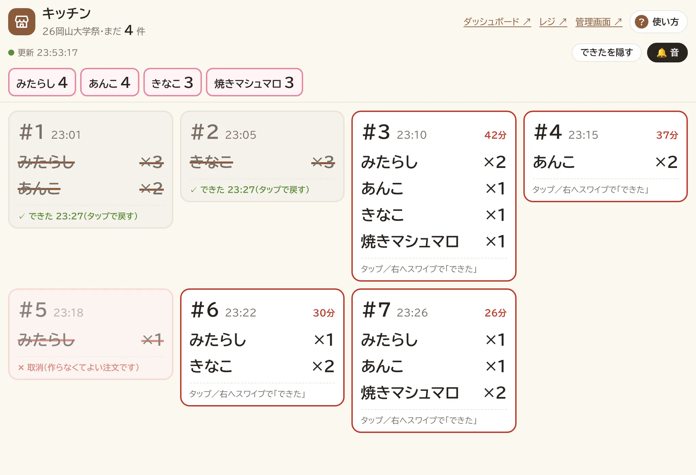
</p>

## 当日の注文の流れ

これまでは注文の味を大学ノートに書き、厨房がノートを見て作っていました。この版から、レジで記録した注文がそのままキッチン画面に届きます。

1. **レジ**（`/admin`）：お客さんの注文を聞き、味のボタンを本数だけタップ → 支払方法 → 確認画面で味を読み上げて「はい（記録する）」
2. **キッチン**（`/kitchen`）：注文が届いた順に並ぶ（数秒で届き、音が鳴る）。上のピンクの枠の「味ごとの合計」を見てまとめて焼く
3. 作り終わったら注文を **タップ（または右へスワイプ）** → 打ち消し線が引かれ、レジの「最近の会計」にも「✓できた」が出る
4. 注文番号（#）はレジとキッチンで共通。受け渡しや「#12 の味は？」のやりとりに使う
5. レジで取り消した注文は、キッチンに赤い線の「取消」で出る（作らなくてよい）

| レジ：味ごとに入力 | レジ：確認画面 | キッチン（スマホ） |
|---|---|---|
| 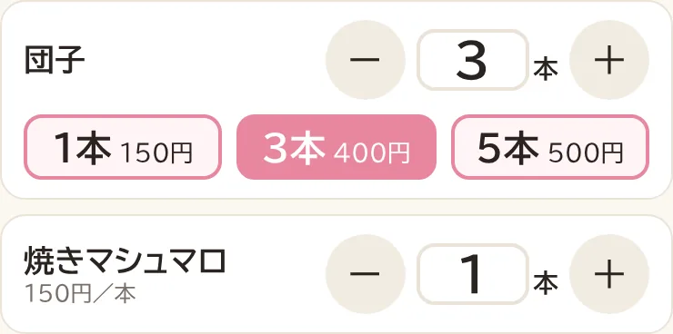 | 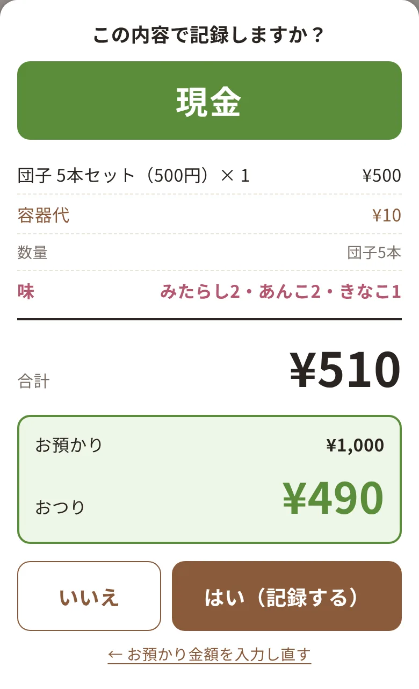 | 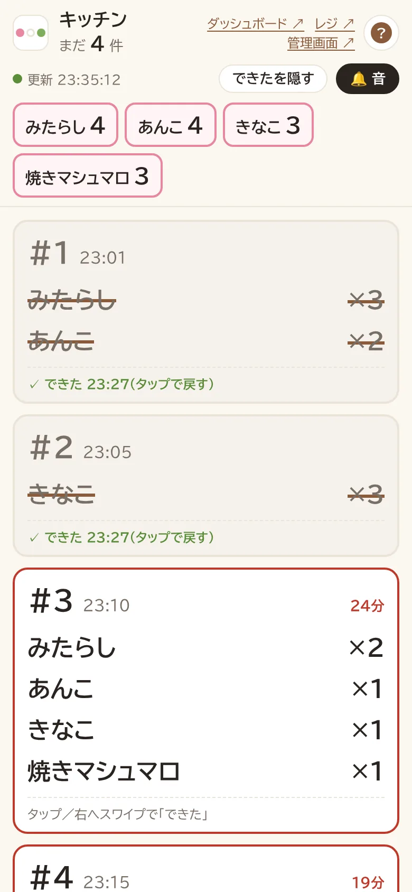 |

## できること

**ダッシュボード**（1分ごとに自動更新）
- 現在の売上（商品代と容器代の内訳つき）、目標金額、達成率のバー
- 目標まであといくらか（達成後は「🎉 達成！ ¥X の黒字（見込）」と表示）
- **目標に対する売上の内訳（円グラフ）**: 円全体が目標金額。商品ごとの売上と容器代を色分けし、届いていない分はグレーの「未達」。中央に達成率、下に金額と目標に対する割合の一覧。目標を超えたら円全体は売上合計になります
- **今日の1時間ごとの売上（棒グラフ）**: 営業時間 9:00〜19:00 を 1 時間ごとに（`src/index.js` の `OPEN_HOUR` / `CLOSE_HOUR`）。棒に触れるとその時間帯の売上・件数・客単価。営業時間外の会計はグラフの下に件数と金額
- **客単価**（売上合計 ÷ 会計件数、取消を除く）
- **目標達成の目安（1時間あたり）**: 目標までの残り ÷ 今日の閉店（19:00）までの残り時間。直前の1時間の実績と比べて足りているかを表示し、1時間ごとの棒グラフにも点線で表示
- 商品ごとの売れた数と、セットごとの個数、**味ごとの数**（味を登録した商品）
- 支払方法ごとの内訳（現金 / PayPay / d払い）

**レジ**
- ログイン時に **担当者名** とパスワードを入力（交代するときは「ログアウト」から入れ直す）
- 商品（団子・焼きマシュマロなど）ごとに **数を入れるだけで、お客さんに一番有利なセットを自動で組む**
  - セットの数量ボタン（団子なら「1本」「3本」「5本」）でその数をすぐ入力、それ以外は ＋/− で増減、数字をタップして直接入力も可
  - 例: 団子4本 → 3本セット＋1本（550円）、7本 → 5本セット＋1本×2（800円）
  - 何本か足したほうが安くなるとき（例: 団子4本より5本のほうが安い）は「あと1本で合計¥520（¥40安く）」と提案を表示
  - 1会計で複数の商品を一緒に記録できます
  - セットの組み方と金額はサーバー側でも計算し直します。会計中に管理画面で価格が変わった場合は記録せず、画面を更新して確認を求めます
- **味ごとの注文**：管理画面で商品に味（例: みたらし、あんこ、きなこ）を登録すると、その商品は「何本」ではなく **味ごとに** 数を入れます
  - 味のボタンをタップした回数がその味の本数（ボタン左下の − で減らす）。右上の「計 N本」に合計を表示
  - セットの組み方と金額は、味に関係なく合計の本数で決まります（例: みたらし2＋あんこ1＋きなこ1＝4本 → 3本セット＋1本）
  - 足したほうが安くなるときの提案は「あと1本で¥50お得（味を聞いて追加）」。味を聞いて、その味のボタンで足す
  - お会計・確認画面・最近の会計・会計の一覧に味の内訳を表示。CSV では明細ファイル（`sale_items.csv`）に味ごとに 1 行で出力
  - 記録した味はキッチン画面に注文として届きます。最近の会計には会計番号（#）と、キッチンで作り終わった注文に「✓できた」を表示
  - 味を登録していない商品は、これまでどおりセットのボタンや ＋/− で数を入れます

  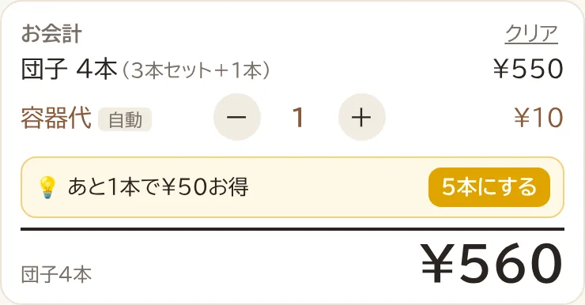
- **容器代を自動で計算して合計に加算**（「容器代の対象」にした商品の、1会計の合計数で判定。初期設定は団子のみ対象）

  | 数 | 容器代（初期設定） |
  |---|---|
  | 1〜2本 | なし |
  | 3本以上 | 10円（何本でも容器1個） |

  容器を2個以上渡すときは、レジの容器代の −/＋ で直します。本数に応じて増やす計算に戻したいときは、管理画面の容器代のルールで「最大の個数」を 0（上限なし）にします。

- 容器代は −/＋ で手動修正もできます（「手動」と表示され、「自動に戻す」で自動計算に戻せます）
- 「現金」「PayPay」「d払い」ボタンを押すと、記録前に **確認のポップアップ** を表示
  - 現金のときは、先に **お預かり金額の入力が必須**（「ちょうど」や 1,000円などのボタンあり。足りないと先に進めない）
  - 確認画面に、内訳・合計金額・支払方法（色つきで強調）、現金ならお預かりと **おつり** を表示
  - 「はい」で記録、「いいえ」でお会計の画面に戻る（カートはそのまま）
- 最近の会計（最新5件）から「取消」できます（「戻す」で元に戻せます）
- それより前の会計は「すべての会計を見る」から **会計の一覧ページ**（`/history`）へ。日付ごとの一覧、50件ずつ読み込み、取消／戻すも可
- **売上の CSV ダウンロード**（デジタル庁「[機械判読可能なデータの表記方法の統一ルール](https://github.com/digital-go-jp/machine_readability_rule)」に準拠。項目の定義は **[docs/csv-spec.md](docs/csv-spec.md)**）
  - **手集計用**（`sales_ja.csv`）：Excel で開いて人が集計する向け。1 行 = 1 会計、日本語の見出し、`団子 みたらし(本)` のように味ごとの本数を 1 列ずつ並べるので、列の合計だけで集計できる。要件と項目は **[docs/csv-tally-spec.md](docs/csv-tally-spec.md)**
  - **データ分析用**（機械判読用）：3 ファイルに分けて出力し、`sale_id`（会計番号）でつながる

    | ファイル | 1 行の単位 | 主な項目 |
    |---|---|---|
    | `sales.csv`（会計） | 1 回の会計 | 日時、支払方法、販売数、商品代・容器代・合計（円）、担当者、調理完了日時 |
    | `sale_items.csv`（明細） | 1 会計 × 1 商品 × 1 味 | 商品、味、数量、単位（味ごとの集計用。縦持ち） |
    | `sale_packs.csv`（セットの内訳） | 1 会計 × 1 商品 × 1 セットの種類 | セットの数量・価格・個数・金額、混ぜたセットか |

  - 1 行目は英数字の項目名（例: `total_amount_yen`）、2 行目からデータ。1 セル 1 データ、金額は円の整数（単位は項目名の `_yen`）、日時は ISO 8601（`2026-11-02T11:48:26+09:00`）、空欄は「値がない」でゼロとは区別
  - UTF-8（BOM 付き。Excel でも文字化けしない）。プログラムで読むときは URL に `?bom=0` を付けると BOM なし
  - 取り消した会計は含めません（データベースには取消フラグ付きで残っています）
- 操作の記録（取消・戻す・ログイン・パスワード変更など、誰がいつしたか）
- 管理画面へのリンク（目標金額の変更、レジのパスワード変更、締め出しは管理画面から）

**キッチン（注文キュー・`/kitchen`）**
- 大学ノートの代わりに、レジで記録した注文を **届いた順に** 並べて表示します（3秒ごとに自動更新）
- ログインは名前＋レジ用パスワード（レジと同じ。3日間有効）。キッチン用のスマホ・タブレットで開きっぱなしにして使う想定。タブレット横向きでは複数列に並びます
- 各注文に会計番号（#）、時刻、注文からの経過時間、味ごとの数（味のない商品は商品名）

  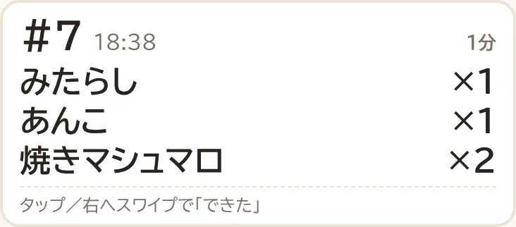

- 作り終わった注文は **タップ** または **右へスワイプ** で「できた」→ 左から打ち消し線が引かれます。スワイプは、カードが緑になり「離すと『できた』」と出たところで離すと確定（途中で離すと何もしない）
- 間違えたら、もう一度タップ／左へスワイプ／画面下の「元に戻す」で戻せます。「できた」はほかのキッチン端末と、レジの「最近の会計」（✓できた）にも反映

  | スワイプ中 | できた | 取消 |
  |---|---|---|
  | 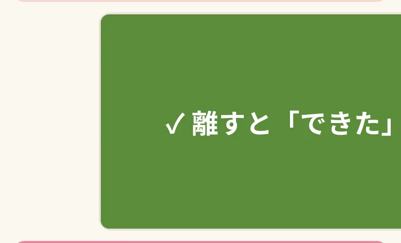 | 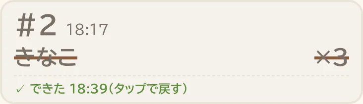 | 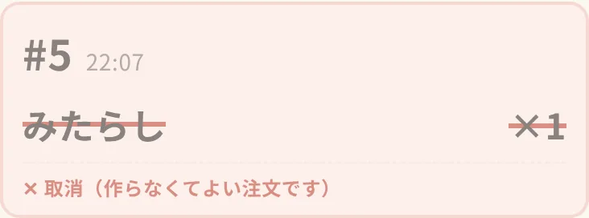 |

- 上の帯に「まだ N件」と、まだ作っていない分の **味ごとの合計**（まとめて焼くとき・タレの準備の目安）

  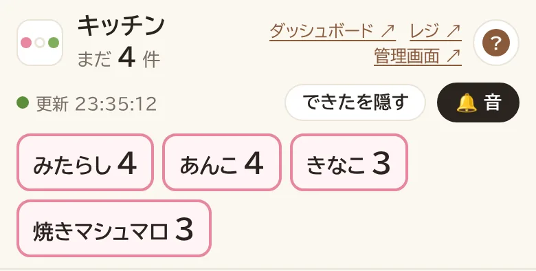

- 注文から **10分でオレンジ、15分で赤** の枠になります（`public/kitchen.html` の `LATE_MIN` / `VERY_LATE_MIN`）
- レジで取り消した注文は赤い線と「取消」で表示し、味ごとの合計にも入れません
- 「できたを隠す」で、できた注文と取消を一覧から隠せます（端末ごとの設定）
- 新しい注文が届くと音（🔔）とピンクのハイライトでお知らせ（ブラウザの制限で、画面を一度タップしてから鳴ります。「🔕 音なし」に切り替え可）
- 表示は今日（日本時間）の注文だけ。オンライン専用です（電波がない間にレジで打った注文は、レジが送信してから届きます）
- 3秒ごとの確認は、変化がなければ版番号（`settings.kitchen_rev`）を 1 行読むだけなので、D1 の無料枠をほとんど使いません。会計・取消・「できた」のたびに版番号が 1 増え、そのときだけ今日の注文を読み直します

**オフライン対応（レジのみ）**
- 会場の電波が途切れても会計を止めないための仕組みです。ダッシュボード・管理画面・会計の一覧はオンライン専用のままです。
- **Service Worker**（`public/sw.js`）がレジ画面（`/admin`）と `pricing.js` をキャッシュするので、電波がない状態で再読み込みしてもレジが開きます（最後に受け取った商品・価格・最近の会計で表示）。
  - ネットワーク優先：つながるときは常に最新版を表示し、つながらない・4秒以上かかるときだけキャッシュを使います。
  - キャッシュ名に版（`VERSION`）が付いています。**アプリを更新したら `public/sw.js` の `VERSION` を変えてデプロイ**してください。新しい版が入ると古いキャッシュは消え、会計の途中でなければ自動で再読み込み、途中なら「新しい版があります」と案内が出ます。
- **会計と取消は、まず端末（localStorage）の未送信キューに保存**し、そのあとサーバーへ古い順に送ります。送れたものからキューを消します。
  - 再送のタイミング：通信が戻ったとき（online イベント）、画面を開き直したとき、15秒ごと、状態の帯の「送信」ボタン。
  - オンライン／オフラインの表示は、端末の通知に加えて10秒ごとの確認通信（`/api/ping`）で判定します（機種によって通知が来ないため）。
  - 会計ごとに端末で会計ID（`client_id`）を付け、サーバーは同じ ID を 1 件として扱うので、何度送り直しても二重計上されません。
  - 取消は「取消にする／戻す」を状態で送るので、何度届いても結果は同じです。
  - 会計の時刻は、端末で会計した時刻で記録されます。
  - オフラインの間に管理画面で価格が変わっていた場合は、**お客さんから受け取った金額（端末の明細）のまま記録**し、操作の記録に「今の価格と違う会計を記録」と残ります。
  - サーバーに受け付けられなかった操作（内容の不備など）は消さずに「送信できなかった操作」として画面に残ります。
- レジ画面の上部に、オンライン／オフラインの状態と**未送信件数（金額）**を常に表示します。最近の会計には未送信のものも「未送信」付きで表示します。
- 未送信が残っている間とオフライン中は、ログアウトできません（送る前にログインが切れるのを防ぐため）。ログインの期限切れや締め出しで送れなくなった場合も、キューは端末に残り、ログインし直すと自動で送ります。
- 最初の 1 回はオンラインでレジを開く必要があります（そのときに画面がキャッシュされます）。

**管理画面（マスター）**
- **商品・価格の管理**: 商品の追加、名前・単位・価格・セット・**味**の変更、容器代の対象の切り替え、販売停止（販売中の切り替え）、並び替え、削除（販売記録がない商品のみ）
  - 1個（1本）の価格は必須（どの数でも組めるようにするため）
  - 価格を変えても、すでに記録した会計の金額は変わりません（会計ごとに、その時の商品名と価格で保存）
- **容器代のルール**の変更（何個まで無料か、何個ごとにいくらか、容器の最大個数）
- 目標金額の変更
- **営業終了／再開**：営業終了にするとレジで新しい会計を記録できなくなり（終了前にオフラインで打った未送信の会計は受け付ける）、ダッシュボードは自動更新を止めて終了時点の集計を表示
- ログイン中の端末の一覧（名前・端末・最終利用時刻）と、1台ずつ／レジ全台の **締め出し**
- レジのパスワードの変更（今のパスワード不要。同時に全台締め出しも可）
- マスターパスワードの変更（ほかの端末のマスターログインは解除）
- ログイン制限（打ち間違いによるロック）の解除
- 操作の記録の閲覧
- 売上の CSV（会計・明細・セットの内訳）のダウンロード
- **売上記録の全リセット（テスト用）**: 取消済みも含めたすべての会計を削除し、会計番号を #1 に戻す。「リセット」の入力とマスターパスワードの再入力が必要。リセット前にレジ端末にたまっていた未送信の会計は、あとで届いても記録されずに破棄される（売上記録の世代番号 `sales_epoch` で判定）。元に戻せないので、本番の営業が始まったら使わない

**ヘルプ**
- 4画面とも、右上に **ほかの画面へのリンク**（ダッシュボード・レジ・キッチン・管理画面のうち、今の画面以外。新しいタブで開く）を同じ位置に置いています
- 4画面とも、画面上部の「?使い方」（ダッシュボードは「?見方」、幅の狭いスマホのレジは「?」だけ）ボタンで、スクリーンショットつきの使い方とよくある質問を表示します（レジ・管理画面・キッチンはログイン画面からも開けます）
- レジのヘルプは電波がなくても開けます（Service Worker で help.css / help.js と、一度表示した画像をキャッシュ）

## セキュリティのしくみ

- ログインに成功すると、ランダムなセッショントークンを **HttpOnly・Secure・SameSite=Strict の Cookie** に入れます。パスワードは端末に保存しません。サーバーにはトークンのハッシュだけを保存します。
- 画面から変更したパスワードは **PBKDF2（SHA-256・10万回）** でハッシュ化して D1 に保存します。一度も変更していないときは secret（`ADMIN_PASSWORD` / `MASTER_PASSWORD`）と照合します。
- **同じ接続元から10分間に5回** パスワードを間違えると、その接続元からは10分間ログインできません（レジとマスターは別々に数えます）。学校の Wi-Fi などでは全員が同じ接続元になるので、巻き込まれたら管理画面から解除してください。ログイン済みの端末には影響しません。
- 担当者名はログイン時にサーバー側でセッションに紐づけるため、会計の記録で別の名前を名乗ることはできません。
- 別のサイトからの書き込みリクエストは拒否します（Origin チェック）。
- 新しいパスワードは8文字以上にしてください。

## 構成

```
public/index.html   ダッシュボード
public/admin.html   レジ
public/master.html  管理画面（マスター）
public/history.html 会計の一覧（レジのログインで見られる）
public/kitchen.html キッチンの注文キュー（レジのログインで見られる）
public/pricing.js   料金計算（セットの組み方・容器代）。レジ画面とサーバーで共通
public/sw.js        Service Worker（レジ画面のオフライン対応。VERSION を更新ごとに変える）
public/help.css     ヘルプ（使い方）ダイアログの共通スタイル
public/help.js      ヘルプダイアログの開閉
public/help/        ヘルプに載せているスクリーンショット
src/index.js        API（Cloudflare Worker）
docs/csv-spec.md    売上 CSV（データ分析用）の項目定義（データ定義書）
docs/csv-tally-spec.md 手集計用 CSV の要件定義・項目定義
wrangler.toml       Cloudflare の設定
```

データは Cloudflare D1（SQLite）に保存されます。テーブルは初回アクセス時に自動で作成されます。

## セットアップ（初回のみ・15分くらい）

必要なもの: Cloudflare アカウント（無料）、Node.js 18 以上が入った PC

```bash
# 1. このリポジトリを取得して依存をインストール
git clone https://github.com/adatchan/mogiten.git
cd mogiten
npm install

# 2. Cloudflare にログイン（ブラウザが開きます）
npx wrangler login

# 3. データベースを作成
npx wrangler d1 create mogiten
#    → 表示された database_id を wrangler.toml の「ここに database_id を貼る」に貼り付けて保存

# 4. デプロイ
npx wrangler deploy
#    → https://mogiten.xxxx.workers.dev が表示されます（これがダッシュボードの URL）

# 5. 初期パスワードを設定（入力を求められるので好きなパスワードを入力）
npx wrangler secret put ADMIN_PASSWORD    # レジ用
npx wrangler secret put MASTER_PASSWORD   # 管理画面用
```

ここで設定したのは **初期パスワード** です。あとから管理画面（`/master`）で変更でき、変更後は画面で設定したほうが使われます。

あとは、
- ダッシュボードの URL を QR コードにして店頭に貼る
- 管理画面（`/master`）の「商品・価格」で、団子の「味」に売る味を「、」区切りで入れて保存する（例: `みたらし、あんこ、きなこ`）
- レジ係の端末で `/admin` を開いて担当者名とパスワードを入れる（3日間ログインしたままになります）
- キッチン用の端末で `/kitchen` を開いて名前（例: キッチン）とレジ用パスワードを入れ、画面を一度タップしておく（新しい注文の音が鳴るように）

で準備完了です。

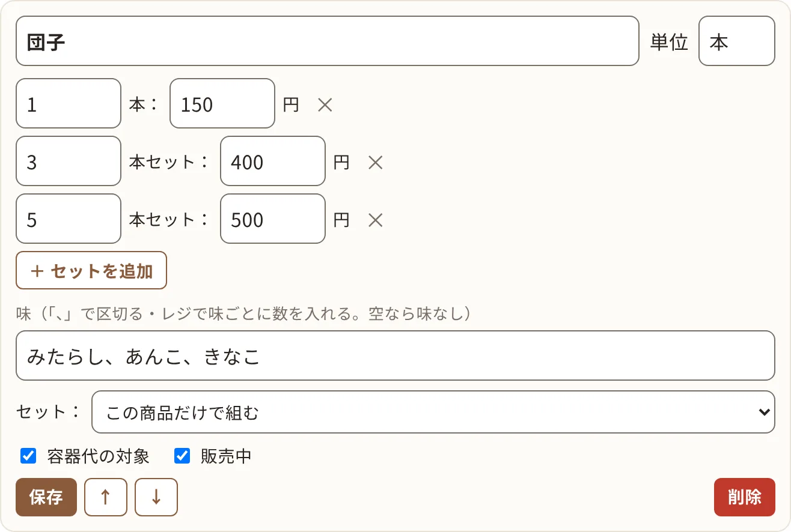

### コードを修正したとき

```bash
npx wrangler deploy
```

URL は変わりません。

### 当日の前にテストデータを消す

```bash
npx wrangler d1 execute mogiten --remote --command "DELETE FROM sale_items; DELETE FROM sale_flavors; DELETE FROM sales; DELETE FROM sqlite_sequence WHERE name IN ('sales', 'sale_items', 'sale_flavors')"
```

## ローカルで試す

```bash
printf 'ADMIN_PASSWORD=dango123\nMASTER_PASSWORD=master123\n' > .dev.vars
npm run dev
# http://localhost:8787/ 、 http://localhost:8787/admin 、 http://localhost:8787/master
```

## メモ

- 味ごとの数は `sale_flavors` テーブル（会計ごと・商品ごと・味ごとの数。味のない商品は味が空）に、キッチンの「できた」は `sales.kitchen_done_at` に保存します。味の名前は会計の時点の名前で残るので、あとで味の一覧を変えても過去の記録は変わりません。
- 商品・価格・容器代のルールは管理画面（`/master`）で変更します。コードを書き換える必要はありません。初期値は `public/pricing.js` の `DEFAULT_PRODUCTS` / `DEFAULT_RULE` です（商品が1つもないときだけ使われます）。
- 売上はお客さんから受け取った金額（商品代＋容器代）で計算しています。目標との比較もこの金額です。
- ダッシュボード（合計・商品ごとの数・支払方法ごとの集計）は URL を知っている人なら誰でも見られます。明細と担当者名はログインしないと見られません。
- マスターパスワードを忘れたときは `npx wrangler d1 execute mogiten --remote --command "DELETE FROM settings WHERE key = 'master_pw_hash'"` で初期パスワード（secret の `MASTER_PASSWORD`）に戻せます。レジ用は `register_pw_hash` です。
